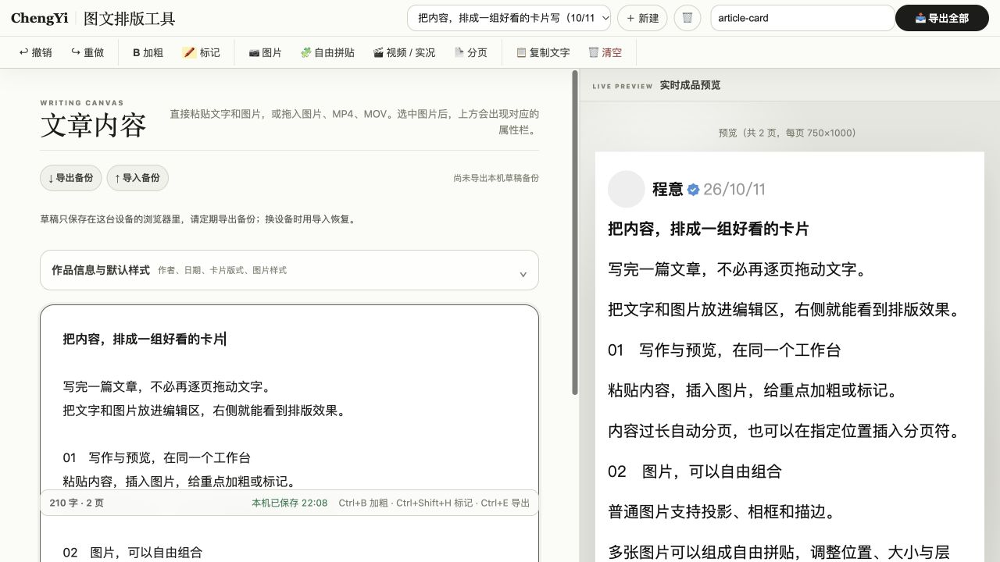
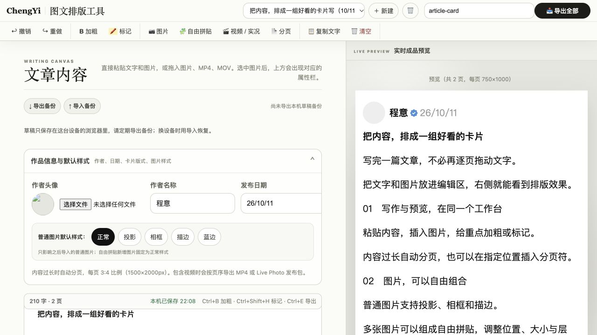

# ChengYi 图文排版工具

把文字、图片和视频排成可发布的 3:4 图文卡片。左侧编辑，右侧实时预览，内容过长自动分页，完成后一次导出。

**无需登录 · 草稿保存在本机 · 支持图片、视频与 Live Photo · MIT 开源**

[**在线体验 →**](https://chengyi-card-layout.chengyi-ai.chatgpt.site/) · [使用步骤](#怎么用) · [本地运行](#本地运行) · [MIT 许可证](LICENSE)

## 主要功能

| 功能 | 可以做什么 |
| --- | --- |
| 写作与排版 | 粘贴文字和图片，给重点加粗、标记；自动分页，也能手动插入分页符 |
| 实时预览 | 编辑时查看成品效果，导出 3:4 卡片，图片输出为 1500×2000px |
| 图片与自由拼贴 | 调整图片宽度，选择投影、相框、描边或蓝边；多图拼贴支持移动、缩放和层级调整 |
| 视频与实况 | 导入 MP4 / MOV，选择 3 秒或 5 秒片段，导出 MP4 或 Live Photo 发布包；需浏览器支持相应媒体能力 |
| 多草稿管理 | 自动保存到本机浏览器，可新建、切换和删除草稿 |
| 备份与恢复 | 导出 / 导入 JSON 备份；含视频时打包 ZIP，一并保存素材，兼容旧工具箱备份 |

## 使用截图

截图来自在线站点，内容为演示草稿。

**编辑与实时预览**：左侧输入内容，右侧查看自动分页后的卡片；顶部提供图片、拼贴、视频和导出入口。



**作品信息与备份**：展开“作品信息与默认样式”设置作者、日期和图片样式；“导出备份 / 导入备份”始终可见。



## 怎么用

1. **打开 [在线工具](https://chengyi-card-layout.chengyi-ai.chatgpt.site/)**，直接在左侧编辑区输入或粘贴内容，无需注册。
2. **加入素材**：点击顶部“图片”“自由拼贴”或“视频 / 实况”；也可以把图片、MP4 或 MOV 拖进编辑区。
3. **调整排版**：选中文字后点击“加粗”或“标记”；选中图片后调整属性。内容自动分页，想指定下一页起点时点击“分页”。
4. **补充作品信息**：展开“作品信息与默认样式”，设置作者名称、头像、发布日期和普通图片默认样式。
5. **导出成品**：检查右侧预览，填写顶部“导出名称”，点击“导出全部”。纯图文导出图片，包含视频时按页序导出 MP4 或 Live Photo 发布包。
6. **保存备份**：点击“导出备份”。换设备或换浏览器后，在新环境点击“导入备份”恢复。

> 草稿只保存在这台设备的浏览器里，请定期导出备份；换设备时用导入恢复。清除站点数据、更换浏览器或域名，都不会自动带走草稿。视频与 Live Photo 处理依赖浏览器媒体能力，遇到能力提示时请使用支持该能力的浏览器。

从旧站（博主工具箱图文工具）迁移：**旧站导出备份 → 新站导入备份**。含视频务必使用 ZIP；恢复会作为独立副本加入，不覆盖现有草稿。

## 本地运行

需要 Node.js 22.9 或更新版本。当前项目没有 npm 运行依赖，无需安装依赖即可启动。

```bash
git clone https://github.com/chengyi-ai/chengyi-card-layout.git
cd chengyi-card-layout
npm run dev
```

打开 <http://127.0.0.1:4173/>。可在 `.env` 中配置 `HOST`、`PORT`；也可用 `npm start` 启动。

```bash
npm test        # 编辑器、草稿、备份、视频等测试
npm run build   # 生成纯静态 dist/
```

## 静态部署

将 `npm run build` 生成的 `dist/` 部署到静态托管平台即可。不需要后端、登录服务、R2、D1 或密钥；第三方浏览器依赖随站点提供，不依赖公共 CDN。

构建会校验第三方依赖的 SHA-256，并生成 `dist/_headers`。安全头是否生效取决于托管平台是否支持该文件，不能仅凭构建成功判断；本地开发服务会返回对应安全头。`manifest.json` 使用相对路径，保留的重置页只清理旧缓存，不清理用户草稿。

## 存储实现

<details>
<summary>查看本机分区、旧数据迁移与备份格式</summary>

草稿只保存在这台设备的浏览器里，请定期导出备份；换设备时用导入恢复。清除站点数据、更换浏览器或站点域名均不能自动带走草稿。

草稿正文使用 IndexedDB `chengyi-card-drafts-v2`，视频及封面使用 `chengyi-card-media-v1`，统一写入 `local` 分区。旧数据库保留原 keyPath `accountId` 以兼容历史数据，这个字段现在固定为 `local`，不表示登录账户。

首次读取会把本源下旧账户分区合并进本机分区。同草稿 ID 按 `updatedAt` 取较新版本；相同时间优先本机版本。删除记录取较新时间，删除时间不早于草稿更新时间时保留删除。素材按草稿 ID、媒体 ID、用途合并，同键取较新 `updatedAt`，相同时间优先本机。迁移标记随 IndexedDB 写入事务提交，旧分区不删除；后续打开不会重新迁移导致草稿复活。旧 localStorage 多草稿及单草稿也会迁移，原账户 key 保留；成功后标记，失败保留原数据供重试。IndexedDB 不可用时正文可回退 localStorage，视频存储仍需要 IndexedDB。

“导出备份”生成 JSON；含视频素材时生成包含 `manifest.json` 和素材的 ZIP。“导入备份”兼容旧版 1/2 JSON 与 3 ZIP，忽略备份的 `accountId`、`userId`、`ownerId` 字段，草稿与素材均落到本机分区。恢复作为独立副本加入，遇到 ID 重复会重命名，并同步更新视频引用。素材写入失败时回滚本次素材，不提交草稿。

从旧站（博主工具箱图文工具）迁移：**旧站导出备份 → 新站导入备份**。跨域不能直接读取旧站浏览器数据库；含视频务必使用 ZIP。

</details>

## 开源许可证与来源

项目代码采用 [MIT License](LICENSE)，允许使用、修改和商业使用，分发时需保留版权及许可证声明。

本工具拆自 `chengyi-creator-toolkit` commit `4b6c9cc`。第三方依赖与改编代码继续遵守各自的许可证，详见 [THIRD_PARTY_NOTICES.md](THIRD_PARTY_NOTICES.md) 和 [vendor/README.md](vendor/README.md)。
